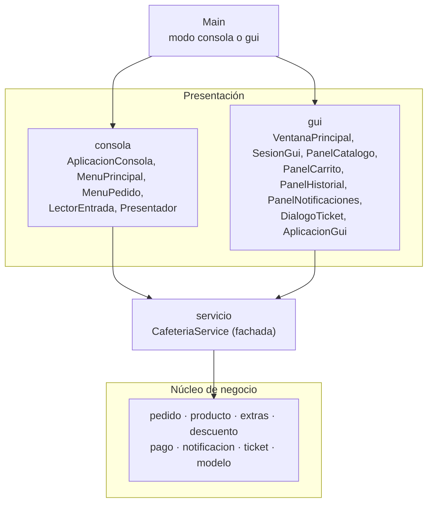

# Arquitectura

**Proyecto:** Sistema de Cafetería · **Integrantes:** Samuel Chaparro, Cristian Daniel Blanco, Juan Diego Afanador

## 1. Tres zonas

| Zona | Paquetes | Responsabilidad |
|---|---|---|
| Núcleo | `modelo`, `producto`, `extras`, `descuento`, `pago`, `pedido`, `notificacion`, `ticket` | Reglas de negocio. No sabe que existe una pantalla. |
| Fachada | `servicio` | Coordina el núcleo y expone las operaciones RF-01 a RF-16. |
| Presentación | `consola`, `gui` | Pedir datos, mostrar resultados y errores. Sin reglas de negocio. |
| Arranque | `Main` | Elige el modo (`consola` por defecto, o `gui`). |

## 2. Reglas de dependencia

1. El núcleo **no importa** `consola`, `gui` ni `javax.swing` (se verifica con una búsqueda de imports; ver la revisión final).
2. `consola` y `gui` **no se conocen entre sí** y ejecutan toda operación a través de `CafeteriaService`. Importan tipos del núcleo solo para leer lo que la fachada devuelve (`Pedido`, `Producto`, `TipoEstado`, `Moneda`…) o para capturar `CafeteriaException`; nunca crean objetos de negocio ni llaman a mutadores del núcleo.
3. No hay ciclos entre paquetes. Para lograrlo, dos decisiones puntuales:
   - `CafeteriaException` vive en `modelo`, que no depende de nadie, así todos los paquetes pueden lanzar errores propios.
   - `descuento` recibe un `ContextoDescuento` en lugar de un `Pedido`, y `notificacion` recibe un `CambioEstado` con datos simples, para que `pedido` pueda depender de ambos sin que ellos dependan de `pedido`.

Dependencias reales entre paquetes:

| Paquete | Depende de |
|---|---|
| `modelo` | (nada) |
| `producto` | `modelo` |
| `extras` | `producto`, `modelo` |
| `descuento` | `modelo` |
| `pago` | `modelo` |
| `notificacion` | `modelo` |
| `pedido` | `modelo`, `producto`, `descuento`, `pago`, `notificacion` |
| `ticket` | `pedido`, `pago`, `modelo` |
| `servicio` | todos los del núcleo |
| `consola`, `gui` | `servicio` (y tipos de lectura del núcleo) |

## 3. Por qué consola y GUI usan la misma fachada

- **Una sola fuente de verdad.** Un descuento mal calculado se corrige en un lugar y se corrige en las dos interfaces (RF-17, RNF-02).
- **Pruebas sin interfaz.** `CafeteriaServiceTest` recorre el flujo completo sin consola ni ventana (RNF-05). Además, `AplicacionConsolaTest` ejecuta la consola con entradas simuladas.
- **Interfaces delgadas.** La consola valida entradas y la GUI arma tablas y botones. Ninguna decide si un pago es válido o si una transición está permitida.
- **Interfaz nueva barata.** Una versión web o móvil (hoy fuera de alcance) solo tendría que hablar con `CafeteriaService`.
- **Notificaciones sin acoplamiento.** La fachada recibe un `Consumer<String>` como salida: la consola le pasa un `println` y la GUI le pasa el panel de notificaciones. El núcleo nunca sabe quién imprime.

## 4. Datos y extensión
- Todo vive en memoria dentro de `CafeteriaService` (catálogo, pedidos, receptores, formatos). Al cerrar, se pierde (RNF-08).
- Puntos de extensión de la fachada sin tocar código existente (RNF-04): `registrarFabrica(FabricaProducto)`, `registrarFormato(FormatoTicket)`, `registrarReceptor(ReceptorEstado)`; `CatalogoOpciones.registrar(...)` para extras; y clases nuevas de `PoliticaDescuento` o `MetodoPago` con su método de la fachada.
