# Diagramas UML

**Proyecto:** Sistema de Cafetería · **Integrantes:** Samuel Chaparro, Cristian Daniel Blanco, Juan Diego Afanador

Todos los diagramas están en Mermaid y usan los nombres reales de clases y métodos del código (`src/main/java/com/cafeteria`). En los diagramas por patrón, el rol del patrón se marca con una nota sobre cada clase. Se omiten getters triviales y las excepciones, salvo cuando son parte del comportamiento.

Índice: [1. Casos de uso](#1-casos-de-uso) · [2. Clases general](#2-diagrama-de-clases-general) · [3. Factory Method](#3-factory-method-productos) · [4. Decorator](#4-decorator-personalizaciones) · [5. Strategy descuentos](#5-strategy-descuentos) · [6. Strategy pagos](#6-strategy-métodos-de-pago) · [7. State](#7-state-ciclo-de-vida-del-pedido) · [8. Observer](#8-observer-notificaciones) · [9. Strategy tickets](#9-strategy-formatos-de-ticket) · [10. Facade](#10-facade) · [11. Secuencia](#11-diagrama-de-secuencia-flujo-principal)

## 1. Casos de uso

Mermaid no tiene un diagrama de casos de uso propio; se representa con un diagrama de flujo (actores a la izquierda, casos de uso como óvalos). Cada caso de uso está disponible por consola y por GUI (RF-17).

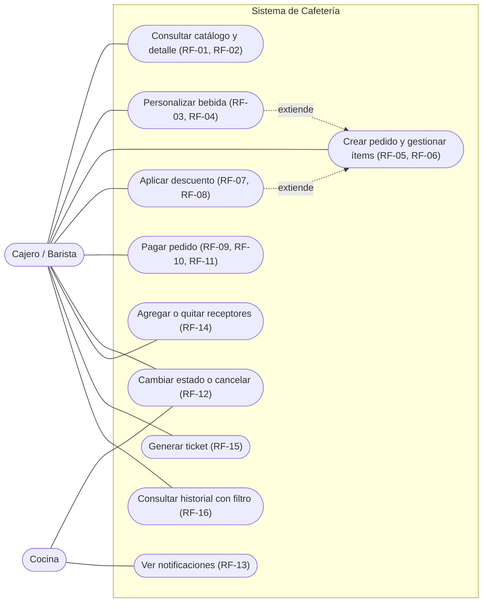

## 2. Diagrama de clases general

Muestra las clases centrales de cada paquete y cómo se relacionan. Los detalles de cada patrón están en las secciones 3 a 10.

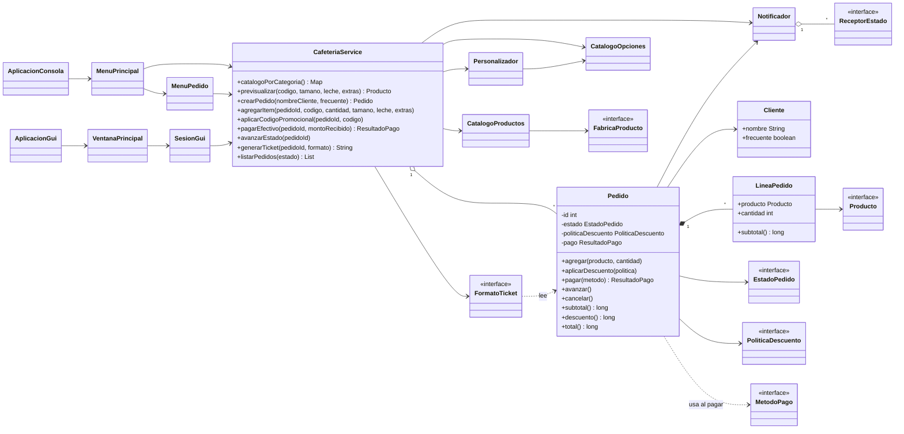

## 3. Factory Method: productos

Área de variación 1. El catálogo recibe fábricas y no conoce las clases concretas de producto.

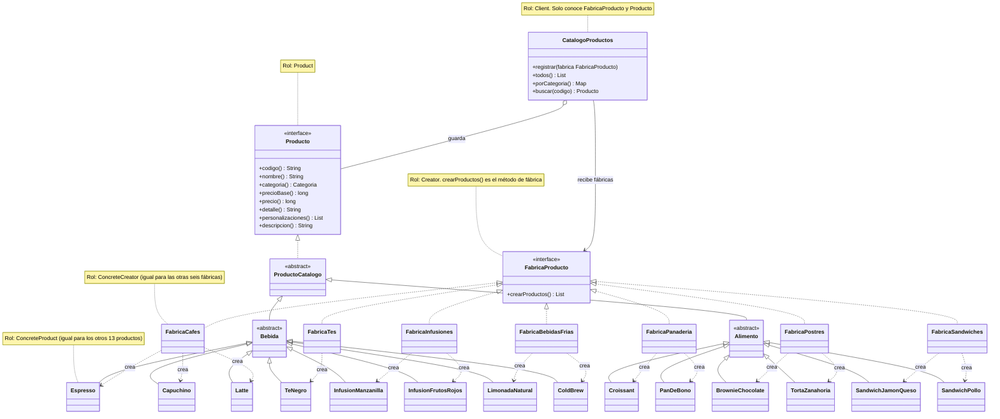

## 4. Decorator: personalizaciones

Área de variación 2. Un decorador envuelve una bebida, suma un recargo y agrega una etiqueta a la descripción.

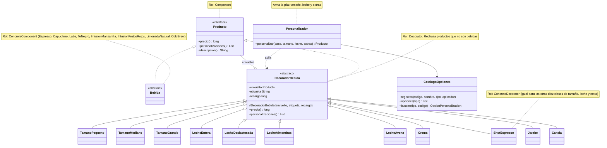

## 5. Strategy: descuentos

Área de variación 3. `Pedido` es el contexto; recibe un `ContextoDescuento` para que el paquete `descuento` no dependa de `pedido`.

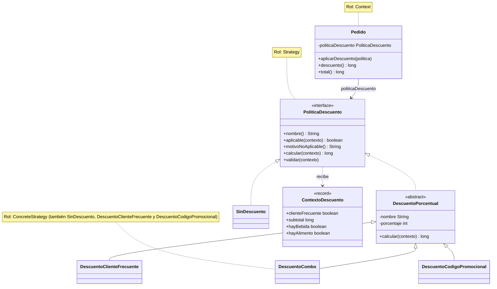

## 6. Strategy: métodos de pago

Área de variación 4. Cada método valida sus propios datos dentro de `pagar`.

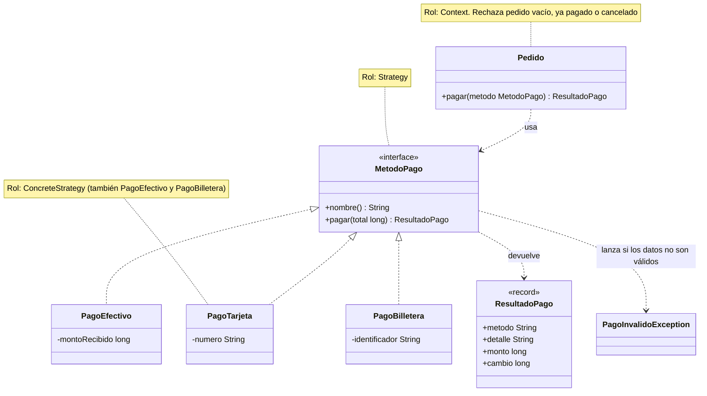

## 7. State: ciclo de vida del pedido

Transiciones válidas: Recibido → En preparación → Listo → Entregado. Se puede cancelar desde Recibido y En preparación. Cualquier otra transición lanza `TransicionInvalidaException`.

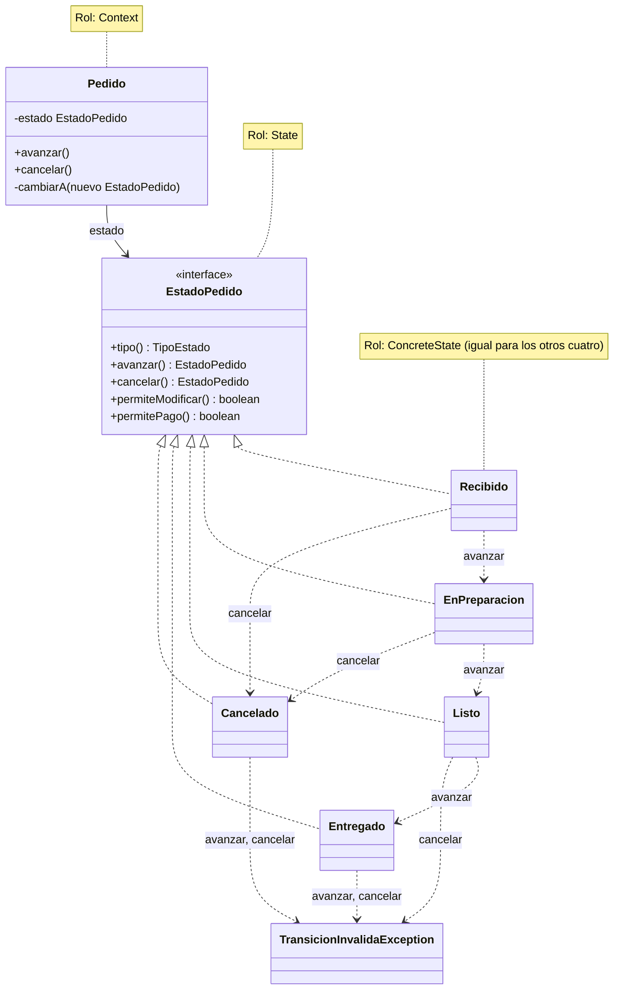

## 8. Observer: notificaciones

Área de variación 5. `Pedido` publica un `CambioEstado` en el `Notificador` y no conoce a los receptores.

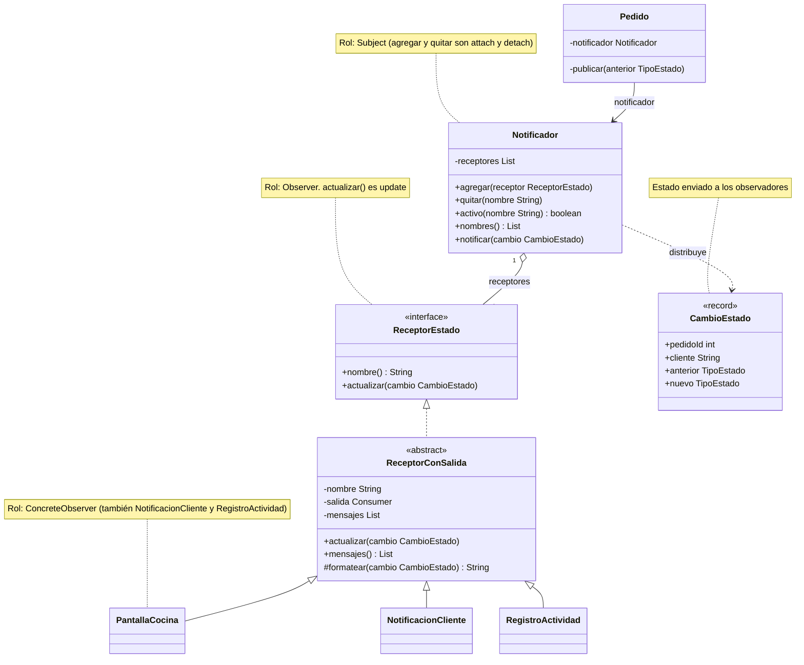

## 9. Strategy: formatos de ticket

Área de variación 6.

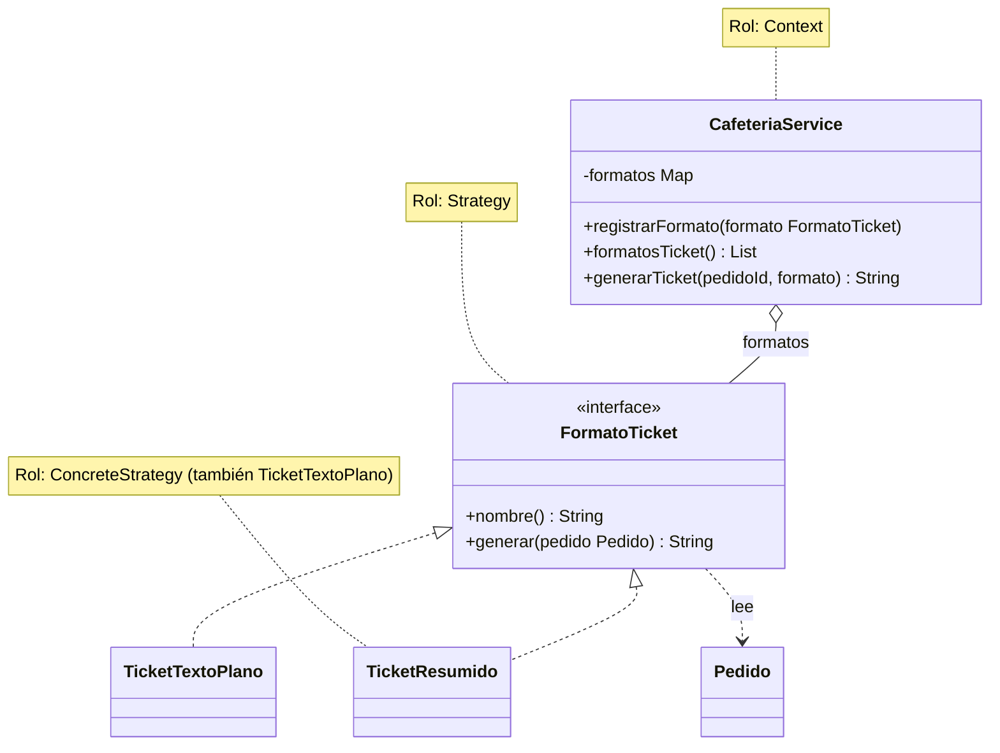

## 10. Facade

Arquitectura (RNF-02). Consola y GUI solo ven `CafeteriaService`.

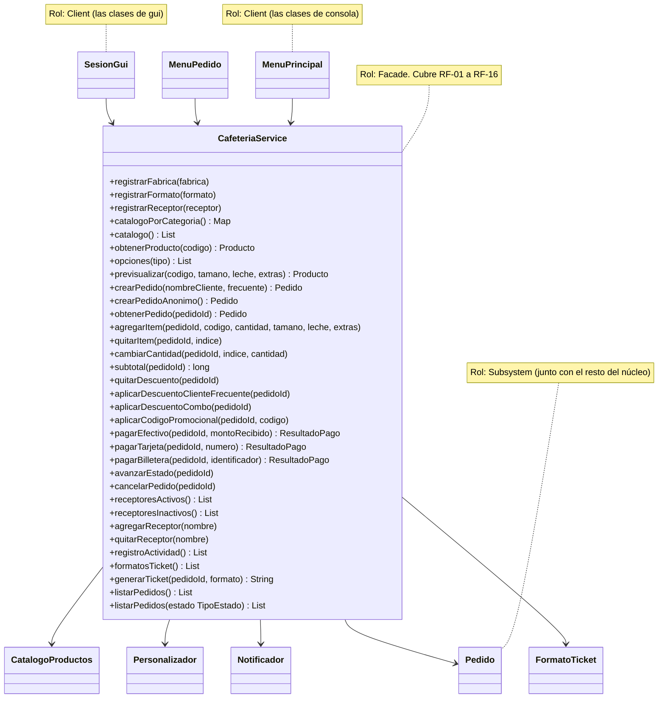

## 11. Diagrama de secuencia: flujo principal

Crear pedido → personalizar → descuento → pago → cambio de estado → notificación → ticket. El "Usuario" es quien opera la consola o la GUI; ambas hacen exactamente estas llamadas a la fachada.

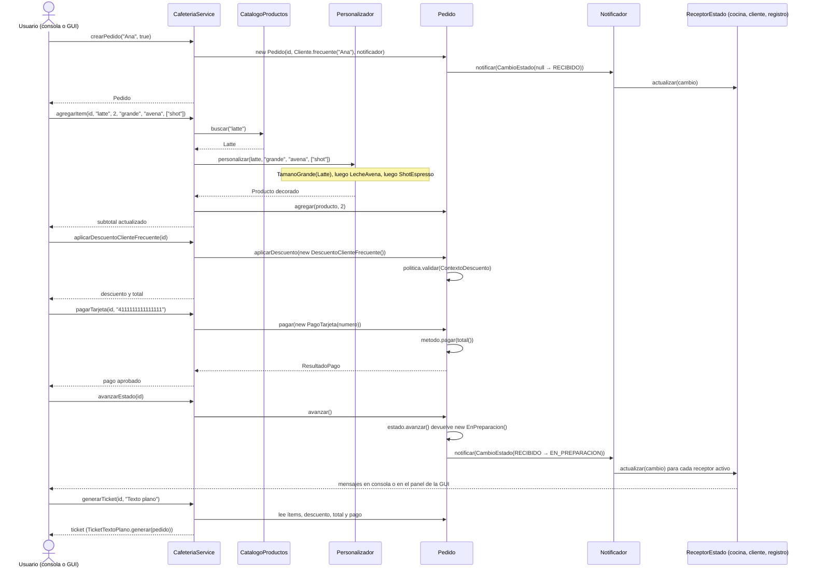
